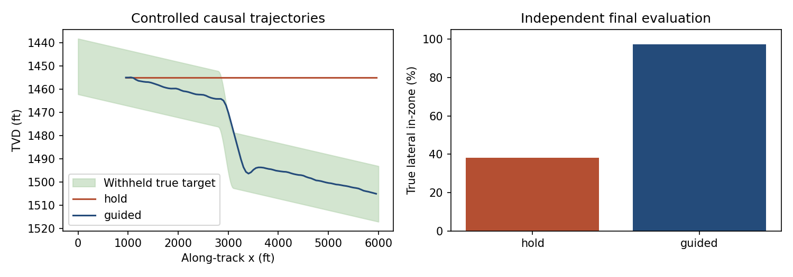

# GeoSteering Workbench

[](https://github.com/Tanner-Eischen/GeoSteering/actions/workflows/ci.yml)
[](LICENSE)

**Can sparse offset wells and progressively revealed logs support a defensible interpretation of a changing target horizon?**

GeoSteering is a local scientific workbench with a reproducible four-well synthetic case study. It imports LAS and surveys, correlates geological markers, solves a constrained landing, versions interpretations, records decisions, and exports a report with figures and independent evaluation.

Two modes have different meanings:

- **Interpretation replay:** reveal a fixed recorded path and its logs. Recommendations document interpretation; they do not change that path.
- **Causal simulation:** apply bounded HOLD/BUILD/DROP commands, integrate the resulting trajectory, and sample new logs from a fixed spatial geological model.

The reference scenario uses a 24-ft target, three offset wells, a 5,000-ft lateral, and a localized structural disturbance. The seed-123 controlled comparison places approximately **38.1%** of the HOLD lateral and **97.2%** of the observation-guided lateral in zone. These are measured outcomes in an idealized synthetic model, not evidence of operational drilling performance. The complete numerical summary is generated with the command below.



## Reproduce the complete case study

Run from this repository directory with Python 3.11 or newer. The verified release profile uses CPython 3.12 and hash-locked dependencies. No paid APIs, browser automation, or external datasets are required.

```powershell
python -m venv .venv
.venv\Scripts\Activate.ps1
python -m pip install -e ".[test,dev]"
python -m tools.run_case_study --out output/case-study --seed 123
```

Choose a new output directory for every build. The command creates the scenario, imports all four wells, estimates a baseline using offset markers only, solves the landing plan, completes the replay, evaluates withheld truth, runs both causal strategies, and renders required PNG figures and a PDF using Matplotlib Agg.

Outputs under `output/case-study/project/exports/`:

- `summary.json`: deterministic numerical results and historical diagnostics.
- `artifacts.json`: selected run/plan IDs, report and figure paths.
- `decision_log.csv`, `plan_demo.csv`, and the PDF report.

The run manifest records input SHA-256 hashes, scenario version, seed, coordinate reference, code revision, and whether the working tree was dirty. UUIDs and timestamps belong to provenance; they are excluded from the deterministic numerical comparison.

```powershell
python -m tools.compare_strategies --help
python -m pytest
python -m ruff check app tools tests app.py
python -m build
```

## Explore the workbench

```powershell
streamlit run app.py
```

Use Dashboard's case-study loader to start a guided replay at landing. You can also start a **new isolated run** in Interpretation and Steering. Earlier runs and their histories remain available for export.

Follow the workflow: scenario/data provenance, Data QC, Correlation Panel and offset picks, Planning, Interpretation and Steering, then Report Export. Reports and other operator views respect the selected run's revealed depth. Geological truth is shown only after completion.

For individual imports, each well folder contains `survey.csv`, `logs.las`, optional `markers.csv`, and an explicit `reference.json` for spatial interpretation. See [methods](docs/methods.md) for the coordinate contract and survey tie-ins. Existing MD-only projects remain readable; new spatial studies require explicit references and offset-derived models.

Standalone sample generation and bootstrap remain available:

```powershell
python -m tools.generate_sample_data --out output/sample --seed 123
python -m tools.bootstrap_demo_project --project-root output/demo --sample-root output/sample
python -m tools.export_report output/demo
```

Omit `--steps` for a complete bootstrap; an explicit step count produces a clearly marked partial replay. Existing populated project and scenario outputs are never silently replaced.

## Scientific evidence and limits

Read the [case study](docs/case-study.md), [methods](docs/methods.md), and [limitations](docs/limitations.md). The scientific tests cover analytic trajectory/tie-in cases, exact interval scoring, truth/future isolation, immutable history, seed reproducibility, causal command effects, DLS limits, and PDF content/figures.

This is training and portfolio software. The sensor model intentionally provides a calibrated signed stratigraphic signal; real gamma-ray inversion is substantially more ambiguous. The steering model is simplified kinematics. There is no rig telemetry, downhole-tool physics, WITSML integration, well-control model, or operational certification.

Required report figures use Matplotlib and do not require Kaleido or a browser.

## Repository layout

- `app/`: application, scientific models, services and reporting.
- `tools/`: import, case-study generation, comparison and export commands.
- `tests/`: automated validation.
- `case_studies/`: versioned synthetic scenario and expected numerical results.
- `docs/`: current case study, methods, limitations and published figures.
- `data/volve/`: retained real-well source data and imported legacy project; see its README.
- `output/`: generated artifacts; the verified reference build is retained locally.
- `venv/`: local Python environment, excluded from version control.

## License

This project is available under the [MIT License](LICENSE).

## Verified release package

The current 0.2.3 source includes actual local browser workflow verification,
project-session isolation, selected PDF/comparison downloads, visible synthetic
calibration limits and guarded advances. See the [versioned browser QA report](reports/browser-qa-2026-11-01/README.md).
The [non-UI handler/export/reopen acceptance](docs/implementation/GS02_OPERATOR_WORKFLOW_2026-11-01.md)
remains separately recorded. For the request contract, see
[request contract, compatibility and local validation](docs/implementation/GS02_IDEMPOTENCY_2026-11-01.md).
Browser coverage is the recorded local Chrome desktop/half/narrow viewport
profile; it is not field validation or general browser/device certification.
Original 0.2.0 evidence retains its historical source identity.

The 0.2.0 release uses platform-specific hash locks, exact packaged-source
provenance, and a read-only verifier for saved and relocated projects. See
[release installation and checks](docs/RELEASE.md). The release evidence records
which clean-install, numerical, persistence, export and PDF checks were executed.
