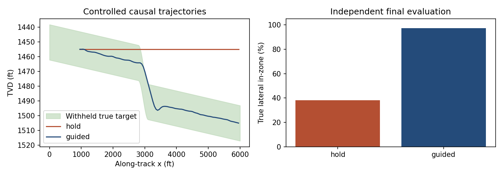

# GeoSteering Workbench

[](https://github.com/Tanner-Eischen/GeoSteering/actions/workflows/ci.yml)
[](LICENSE)

**Can sparse offset wells and progressively revealed logs support a defensible interpretation of a changing target horizon?**

GeoSteering is a local scientific workbench with a reproducible four-well synthetic case study. It imports LAS and surveys, correlates geological markers, solves a constrained landing, versions interpretations, records decisions, and exports a report with figures and independent evaluation.

Two modes have different meanings:

- **Interpretation replay:** reveal a fixed recorded path and its logs. Recommendations document interpretation; they do not change that path.
- **Causal simulation:** apply bounded HOLD/BUILD/DROP commands, integrate the resulting trajectory, and sample new logs from a fixed spatial geological model.

The reference scenario uses a 24-ft target, three offset wells, a 5,000-ft lateral, and a localized structural disturbance. The seed-123 controlled comparison places approximately **38.1%** of the HOLD lateral and **97.2%** of the observation-guided lateral in zone. These are measured outcomes in an idealized synthetic model, not evidence of operational drilling performance. The complete numerical summary is generated with the command below.



## Reproduce the complete case study

Run from this repository directory with Python 3.11 or newer. The verified release profile uses CPython 3.12 and hash-locked dependencies. No paid APIs, browser automation, or external datasets are required.

```powershell
python -m venv .venv
.venv\Scripts\Activate.ps1
python -m pip install -e ".[test,dev]"
python -m tools.run_case_study --out output/case-study --seed 123
```

Choose a new output directory for every build. The command creates the scenario, imports all four wells, estimates a baseline using offset markers only, solves the landing plan, completes the replay, evaluates withheld truth, runs both causal strategies, and renders required PNG figures and a PDF using Matplotlib Agg.

Outputs under `output/case-study/project/exports/`:

- `summary.json`: deterministic numerical results and historical diagnostics.
- `artifacts.json`: selected run/plan IDs, report and figure paths.
- `decision_log.csv`, `plan_demo.csv`, and the PDF report.

The run manifest records input SHA-256 hashes, scenario version, seed, coordinate reference, code revision, and whether the working tree was dirty. UUIDs and timestamps belong to provenance; they are excluded from the deterministic numerical comparison.

```powershell
python -m tools.compare_strategies --help
python -m pytest
python -m ruff check app tools tests app.py
python -m build
```

## Explore the workbench

```powershell
streamlit run app.py
```

The sidebar groups pages into **Prepare data**, **Interpret and steer**, and
**Review and export**. **Open / create project** opens a full-width setup page;
**Import well data** opens file uploads or a batch folder review with editable
well names, file checks and persistent per-well results. After importing, use
Data QC for warnings and Well Viewer for the acquired logs.

Main inspection charts have **Pan**, **Box zoom**, **Reset view**, and an optional
**Wheel zoom** control. Wheel zoom starts off so scrolling over a chart can
continue down the page. Correlation's **Wells per chart** displays one, two or
three tracks without changing the wells selected as interpretation evidence.
The **Correlate & edit** workspace keeps the chart beside the marker editor and
follows the well being edited. Orange dashed lines preview unsaved depth changes;
**Update Marker** saves them. Chart zoom is retained through these edits and saves.
**View options** holds alignment/scaling/group settings, and **Interpretations**
holds model saving and evidence. Marker edits always use MD, even in a TVD view.
Changing pages opens the new page at its header. Depth limits and curve ranges change the display;
marker edits explicitly save to the selected well. Planning refreshes its preview
automatically when you press Enter or leave an edited field, and offers a direct CSV download. Its **Plan & preview**
workspace keeps the inputs and save actions beside a pinned trajectory/DLS chart.
Invalid or incomplete inputs show validation feedback and block saving until corrected.
**Save Plan** is still explicit. **Details & data** holds captured model evidence and station tables.
Steering's
**Steer** tab keeps acquired-data charts beside the command and evidence panel.
Use **Path + preview** for causal next-station geometry and **Chart controls**
for pan/zoom/reset. The chart stays visible while expanding interpretation
controls on wider screens. **History & results** and **Run setup** hold the
secondary workflows; very narrow screens stack the panels.

Use Dashboard's case-study loader to start a guided replay at landing. You can also start a **new isolated run** in Interpretation and Steering. Earlier runs and their histories remain available for export.

In Correlation, save an interpretation from the offset wells you selected. In
Planning, choose that saved version; its evidence and model are pinned into the
plan and the next run. Causal steering previews show requested/effective
inclination, next-station geometry, DLS and clipping before advancement. The
preview uses acquired positions and public mechanics without revealing future
measurements or true geology.

Use **Decision Review** to revisit a saved step. **At decision** stops at the
observations known before the next interval and shows the last metric available
then; **After interval** adds the acquired observations and its original metric.
The selected interpretation, prior version, rationale and boundary changes stay
attached to that decision.

Fork an unfinished causal run, record alternative commands, then open **Run
Comparison**. Related branches share one experiment and are clipped to the same
acquired station. Independent scores unlock only after both branches finish.
The **Evaluation** page presents true placement, interpretation errors, lateral
DLS and downloads for the selected completed run, with links back to decisions
and report export.

For the known synthetic GR model, enable **uncertainty ensemble** when creating
a new isolated run. New runs default to a calibration-sensitivity ensemble:
five persistent GR-bias assumptions retain their own geological alternatives.
**Uncertainty** shows the interval envelope across those assumptions, minimum
conditional effective model count, and a range of next-command probabilities.
The narrower equal-weight mixture remains separately labeled. Each snapshot uses only
acquired measurements and survives retries, forks and historical review. This
model is separate from the original manually interpreted boundaries and assumed
uncertainty band.

The separate [34-trial uncertainty study](case_studies/uncertainty_v1/README.md)
measures coverage and width without retuning the model. Nominal 90% center
intervals achieved 70.89% posterior coverage across the evaluation cases; a
biased-sensor trial covered just 3/101 stations despite healthy particle
diagnostics. Inspect **Calibration evidence** before interpreting probabilities
as reliable confidence.

The new model addresses this failure by preserving calibration ambiguity. Its
fixed assumptions span -16 to +16 API; GR does not learn their weights. The
envelope is a sensitivity range, not a calibrated 90% confidence interval, and
bias outside the declared range can still defeat it. Original v1 runs and their
frozen evidence remain inspectable. A separate paired study compares both models
on identical observations, separating the reused failure from new evaluation
configurations.

In the [20-pair calibration study](case_studies/calibration_v2/README.md), fresh
posterior center coverage rises from 47.63% to 78.22% for the mixture and 79.43%
for the envelope, with wider intervals and no median-accuracy gain. A +28 API
outside-support trial still covers 0/101 posterior stations. Those failures
remain in the app's evidence view and the updated [case study](docs/case-study.md).

```powershell
python -m tools.run_uncertainty_study --out output/uncertainty-study
python -m tools.run_calibration_study --out output/calibration-study
```

Open **Robustness Study** for the separate frozen 132-trial benchmark: eight
held-out evaluation configurations compare HOLD, an offset-derived plan and
guided steering under changed geology and imperfect sensors. Mean evaluation
placement is 28.34%, 39.29% and 85.83%, respectively; the worst guided trial is
37.31%. These descriptive synthetic results include failure cases and do not
establish field performance. See the [protocol and complete results](case_studies/robustness_v1/README.md).

```powershell
python -m tools.run_robustness_study --out output/robustness-study
```

Follow the workflow: scenario/data provenance, Data QC, Correlation Panel and offset picks, Planning, Interpretation and Steering, then Report Export. Reports and other operator views respect the selected run's revealed depth. Geological truth is shown only after completion.

For individual imports, each well folder contains `survey.csv`, `logs.las`, optional `markers.csv`, and an explicit `reference.json` for spatial interpretation. See [methods](docs/methods.md) for the coordinate contract and survey tie-ins. Existing MD-only projects remain readable; new spatial studies require explicit references and offset-derived models.

Standalone sample generation and bootstrap remain available:

```powershell
python -m tools.generate_sample_data --out output/sample --seed 123
python -m tools.bootstrap_demo_project --project-root output/demo --sample-root output/sample
python -m tools.export_report output/demo
```

Omit `--steps` for a complete bootstrap; an explicit step count produces a clearly marked partial replay. Existing populated project and scenario outputs are never silently replaced.

## Scientific evidence and limits

Read the [case study](docs/case-study.md), [methods](docs/methods.md), and [limitations](docs/limitations.md). The scientific tests cover analytic trajectory/tie-in cases, exact interval scoring, truth/future isolation, immutable history, seed reproducibility, causal command effects, DLS limits, and PDF content/figures.

This is training and portfolio software. The sensor model intentionally provides a calibrated signed stratigraphic signal; real gamma-ray inversion is substantially more ambiguous. The steering model is simplified kinematics. There is no rig telemetry, downhole-tool physics, WITSML integration, well-control model, or operational certification.

Required report figures use Matplotlib and do not require Kaleido or a browser.

## Repository layout

- `app/`: application, scientific models, services and reporting.
- `tools/`: import, case-study generation, comparison and export commands.
- `tests/`: automated validation.
- `case_studies/`: versioned synthetic scenario and expected numerical results.
- `docs/`: current case study, methods, limitations and published figures.
- `data/volve/`: retained real-well source data and imported legacy project; see its README.
- `output/`: generated artifacts; the verified reference build is retained locally.
- `venv/`: local Python environment, excluded from version control.

## License

This project is available under the [MIT License](LICENSE).

## Verified release package

The current 0.2.3 source includes actual local browser workflow verification,
project-session isolation, selected PDF/comparison downloads, visible synthetic
calibration limits and guarded advances. See the [versioned browser QA report](reports/browser-qa-2026-11-01/README.md).
The [non-UI handler/export/reopen acceptance](docs/implementation/GS02_OPERATOR_WORKFLOW_2026-11-01.md)
remains separately recorded. For the request contract, see
[request contract, compatibility and local validation](docs/implementation/GS02_IDEMPOTENCY_2026-11-01.md).
Browser coverage is the recorded local Chrome desktop/half/narrow viewport
profile; it is not field validation or general browser/device certification.
Original 0.2.0 evidence retains its historical source identity.

The 0.2.0 release uses platform-specific hash locks, exact packaged-source
provenance, and a read-only verifier for saved and relocated projects. See
[release installation and checks](docs/RELEASE.md). The release evidence records
which clean-install, numerical, persistence, export and PDF checks were executed.
