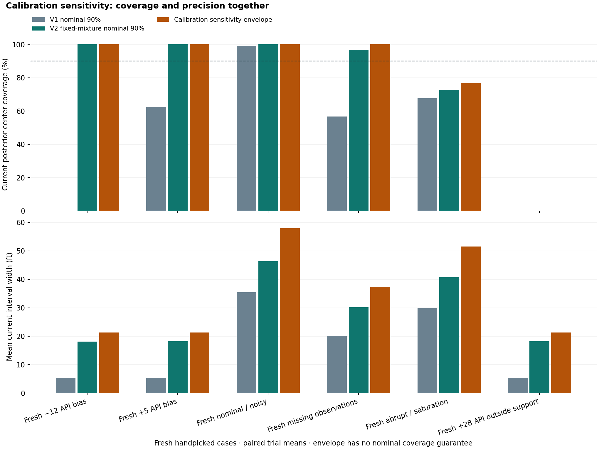
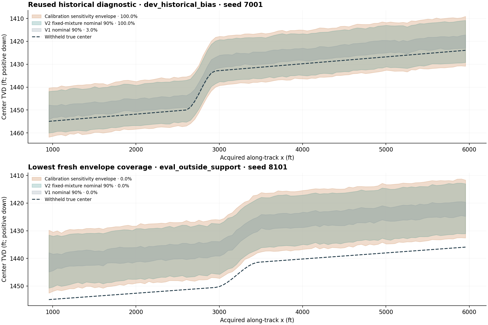

# Paired calibration sensitivity after the v1 bias failure

[Predeclared protocol](PROTOCOL.md) · [Frozen manifest](results/manifest.json) · [Numerical summary](results/summary.json) · [Trial metrics](results/trial_metrics.csv) · [Paired differences](results/paired_metrics.csv)

This study compares unchanged v1 uncertainty intervals with a v2 fixed calibration mixture and a sensitivity envelope. It contains **20 paired trials**: two development pairs and 18 fresh evaluation pairs across six new configurations and three seeds. The 40 model runs are not 40 independent experiments. Both models receive the same instrument samples, offset prior, fixed HOLD path and namespaced particle random streams.

The five hypotheses −16, −8, 0, +8 and +16 API, with fixed equal weights, were selected empirically after observing the old +8 API failure. This is an explicit sensitivity assumption, not identified calibration probabilities. The envelope is the hull of conditional intervals and has no nominal coverage guarantee.

## Fresh evaluation: coverage gains require wider intervals

| Interval | Current posterior coverage (%) | Mean width (ft) | Median-center MAE (ft) | Paired coverage gain (pp) | Paired width increase (ft) |
| --- | ---: | ---: | ---: | ---: | ---: |
| V1 nominal 90% | 47.63 | 16.87 | 9.65 | +0.00 | +0.00 |
| Calibration sensitivity envelope | 79.43 | 35.11 | 9.70 | +31.79 | +18.24 |
| V2 fixed-mixture nominal 90% | 78.22 | 28.62 | 9.70 | +30.58 | +11.75 |

The equal-case mean posterior coverage rises from 47.63% to 78.22% for the fixed mixture and 79.43% for the envelope. Mean widths rise from 16.87 ft to 28.62 ft and 35.11 ft. Median-center MAE does not improve: 9.65 ft for v1 versus 9.70 ft for v2. This is a coverage/precision tradeoff, not evidence that the center was identified more accurately. Neither new posterior summary achieves 90% average coverage on these stress cases.

| Fresh case | V1 posterior coverage (%) | V2 pooled coverage (%) | Envelope coverage (%) | Envelope width (ft) |
| --- | ---: | ---: | ---: | ---: |
| Fresh −12 API bias | 0.00 | 100.00 | 100.00 | 21.26 |
| Fresh +5 API bias | 62.38 | 100.00 | 100.00 | 21.27 |
| Fresh nominal / noisy | 99.01 | 100.00 | 100.00 | 57.98 |
| Fresh missing observations | 56.77 | 96.70 | 100.00 | 37.36 |
| Fresh abrupt / saturation | 67.66 | 72.61 | 76.57 | 51.48 |
| Fresh +28 API outside support | 0.00 | 0.00 | 0.00 | 21.30 |

## Reused historical diagnostic and fresh failure

The previously observed +8 API trial (`uncertainty_v1/eval_bias/7001`) is explicitly reused as development evidence. Its v1 scores reproduce the original frozen record exactly across all four phases. Posterior center coverage changes from 3/101 stations (2.97%) to 101/101 for both v2 interval types, while mean width grows from 5.30 ft to 18.19 ft pooled and 21.28 ft envelope. The new support was designed after seeing this failure, so its repair is not fresh validation.

The fresh +28 API case lies outside the declared ±16 API support. In seed 8101, all three posterior interval types cover **0/101 stations**. Even the envelope has mean width 21.27 ft while the pooled median has 14.00-ft MAE. V2 mean minimum-conditional ESS is 123.52, and no observation conflicts with every conditional predictive interval. Internal fit and healthy particles therefore do not establish truth coverage or calibration identifiability. All three fresh +28 API trials remain in the aggregate results.

In that same outside-support trial, the envelope covers 98.96% of 250-ft forecast targets and 100% at 500 ft because its widths grow to 33.52 ft and 42.64 ft. Forecast median error remains about 14 ft. Better coverage from a wider band is not automatic evidence of better inference.

## All four phases and explicit denominators

| Phase | V1 coverage / width | V2 pooled coverage / width | Envelope coverage / width | Points per interval type across 18 evaluation pairs |
| --- | ---: | ---: | ---: | ---: |
| 250-ft forecast | 74.94% / 26.57 ft | 78.41% / 34.75 ft | 95.20% / 45.03 ft | 1,728 |
| 500-ft forecast | 79.67% / 34.02 ft | 90.78% / 40.83 ft | 95.18% / 52.82 ft | 1,638 |
| Current posterior | 47.63% / 16.87 ft | 78.22% / 28.62 ft | 79.43% / 35.11 ft | 1,818 |
| Current pre-observation prior | 59.41% / 19.65 ft | 78.27% / 29.99 ft | 79.81% / 37.74 ft | 1,818 |

Current prior and posterior scores share the same 101 truth locations per pair. Forecasts exclude targets beyond the evaluated x domain: 96 valid 250-ft and 91 valid 500-ft targets per pair. Additional paired-origin rows restrict both forecasts to the same 91 origins. Coverage, width and MAE are calculated within each trial, then averaged within each case, with cases receiving equal weight. Correlated spatial points are not independent inferential samples. No population confidence interval or field-calibration claim is made.

Fresh geological signatures and seeds were checked programmatically against both earlier protocols before evaluation; `freshness_audit.json` records their input identities. The repeated historical diagnostic is kept separate. The fresh cases are now observed and cannot be reused as untouched evaluation data after future tuning.

## Reproducible evidence

Run `python -m tools.run_calibration_study --out output/new-calibration-study` into a fresh directory. The executed manifest, protocol and source were captured before fresh evaluation. `frozen_source.zip` preserves executable source; `artifacts.json` indexes all outputs and source copies. The loader verifies the archive, expanded source when present, manifest identity and source fingerprints. Installed wheels can use the source archive without installing archived Python modules.

`histories.jsonl.gz` stores each shared observation sequence, initial v1/v2 states, conditional-health data, interval summaries and prior/posterior/forecast hashes. At all 2,020 acquired events, zero-bias v2 matched paired v1 exactly and all five weights remained 0.2. The complete worst-fresh 101-event pair was replayed against every saved state and forecast hash. `point_metrics.csv.gz`, `trial_metrics.csv`, `paired_metrics.csv` and `diagnostics.csv` provide the scoring evidence.

Earlier robustness and uncertainty-v1 artifacts are preserved. The v2 protocol adds calibration sensitivity; it does not revise their results, identify real-world sensor bias, validate thickness uncertainty or establish operational drilling safety.
