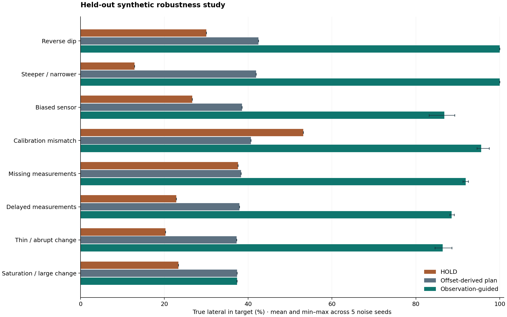
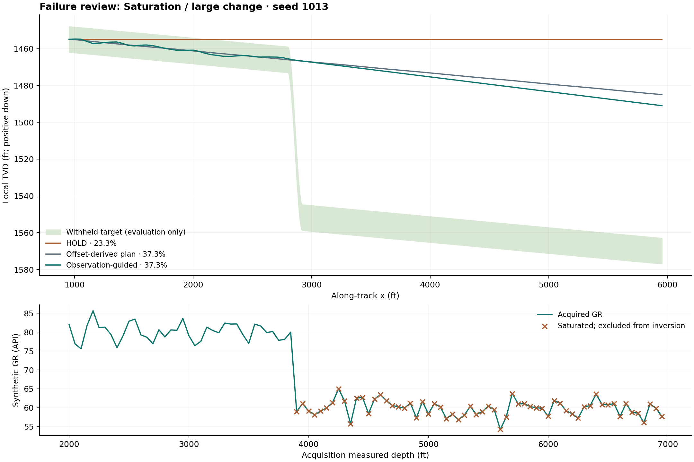

# Held-out synthetic robustness study v1

[Protocol](PROTOCOL.md) · [Executed manifest](manifest.json) · [Numerical summary](results/summary.json) · [Trial metrics](results/trials.csv) · [Paired differences](results/paired.csv)

132 trials: two development cases × two seeds × three strategies, and eight evaluation cases × five seeds × three strategies. The evaluation geology and seed sets are disjoint from development. No controller tuning was performed using evaluation outcomes.

| Evaluation case | HOLD mean (%) | Offset plan mean (%) | Guided mean (%) | Guided seed range (%) |
| --- | ---: | ---: | ---: | ---: |
| Reverse dip | 30.00 | 42.42 | 100.00 | 100.00–100.00 |
| Steeper / narrower | 12.86 | 41.89 | 100.00 | 100.00–100.00 |
| Biased sensor | 26.67 | 38.54 | 86.83 | 83.14–89.25 |
| Calibration mismatch | 53.15 | 40.66 | 95.58 | 94.60–97.52 |
| Missing measurements | 37.55 | 38.31 | 91.92 | 91.24–92.53 |
| Delayed measurements | 22.86 | 37.92 | 88.55 | 88.12–89.14 |
| Thin / abrupt change | 20.29 | 37.23 | 86.43 | 84.54–88.58 |
| Saturation / large change | 23.33 | 37.33 | 37.33 | 37.31–37.33 |

Across these eight handpicked configurations, equal-case mean placement was 28.34% HOLD, 39.29% offset plan and 85.83% guided. Guided exceeded the offset plan in 38 of 40 paired evaluation trials; two differences were slightly negative (minimum −0.01174 percentage points). These counts describe the fixed study and are not population estimates.

The worst guided trial was the saturation/large-change case, seed 1013: 37.31% in target, 78.03 ft maximum overshoot and 62 saturated measurements. The validity wrapper held inclination when no usable measurement arrived, and therefore did not recover the target. All 120 evaluation trials respected the lateral DLS bound under the evaluator tolerance.

The unchanged reference controller assumes a known signed-distance GR calibration. The study adds a predeclared wrapper for missing, delayed and saturated observations. Exact synthetic offset markers, simplified kinematics and coupled geology/sensor stress cases limit the conclusions. Seed ranges show noise sensitivity within fixed geology, not confidence intervals over geological diversity.

The manifest and executable source copies were frozen before execution. The initial uncompressed run was repeated with deterministic gzip history storage; every numerical summary value reproduced exactly. This was a reproducibility check, not a new independent evaluation. The dataset is now observed and cannot be reused as an untouched holdout after future policy changes.

The complete event histories are in `results/histories.jsonl.gz`. `results/artifacts.json` hashes all artifacts and frozen source files; `results/freeze.json` records the executed source fingerprint and environment. Current source may include subsequent app presentation changes; the captured source preserves the evaluated engine.

`results/frozen_source.zip` carries the complete frozen source in installed wheels
as well as repository evidence. The loader verifies the archive checksum, each
archived source against the freeze index, and any expanded source tree. It also
checks manifest and fingerprint consistency across the saved records. Source
archives use sorted entries and fixed timestamps for deterministic reproduction.
