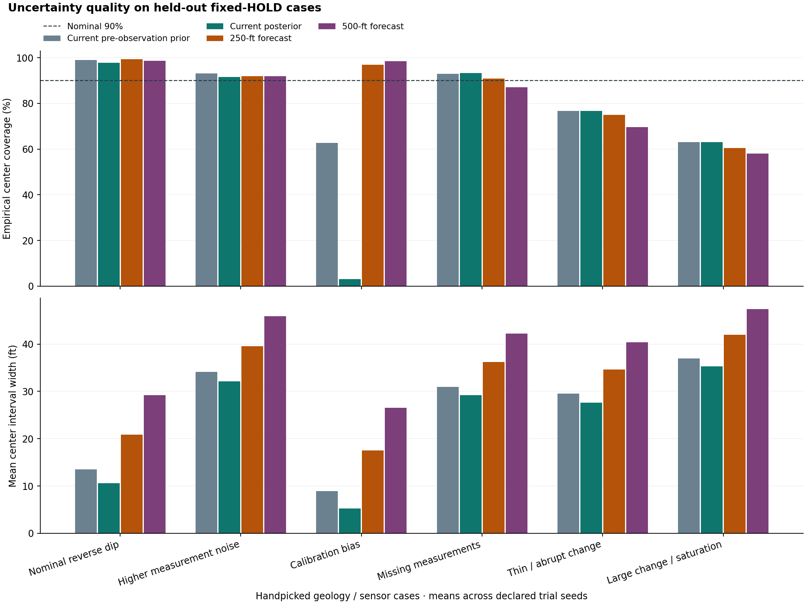
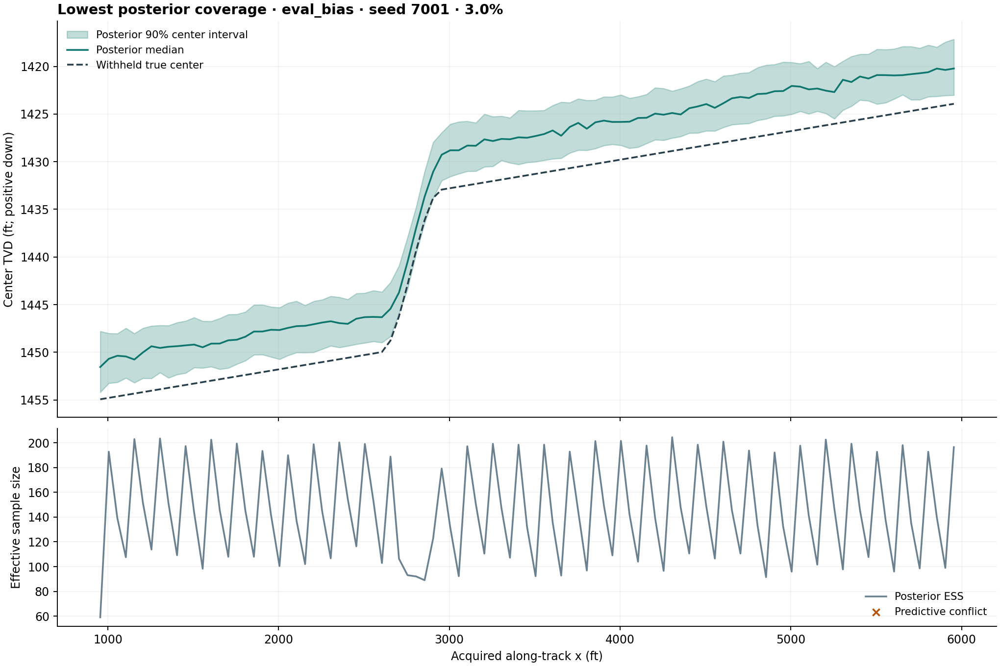

# Uncertainty calibration on a fixed synthetic path

[Predeclared protocol](PROTOCOL.md) · [Executed manifest](results/manifest.json) · [Numerical summary](results/summary.json) · [Trial metrics](results/trial_metrics.csv) · [Diagnostics](results/diagnostics.csv)

The fixed particle model was evaluated in 34 trials: two development controls with two seeds each, and six new evaluation configurations with five seeds each. No settings were tuned to the evaluation outcomes. Each trial used the same 5,000-ft HOLD path and 101 acquired stations. This study assesses geological-center interval quality; it does not compare steering policies.

## Measured evaluation results

| Interval phase | Mean center coverage (%) | Mean width (ft) | Scored points across 30 evaluation trials |
| --- | ---: | ---: | ---: |
| 250-ft forecast | 85.73 | 31.79 | 2,880 |
| 500-ft forecast | 83.96 | 38.59 | 2,730 |
| Current posterior | 70.89 | 23.36 | 3,030 |
| Current pre-observation prior | 81.22 | 25.67 | 3,030 |

The nominal interval level is 90%. Coverage is averaged within each trial, then within cases, with cases receiving equal weight. The points within a trajectory are correlated and are not independent confidence-interval samples. Different forecast horizons have explicit domain exclusions: 96 valid 250-ft forecasts and 91 valid 500-ft forecasts per trial. Additional paired-origin results use 91 origins for both horizons.

| Evaluation case | Prior coverage (%) | Posterior coverage (%) | 250-ft coverage (%) | 500-ft coverage (%) | Posterior width (ft) |
| --- | ---: | ---: | ---: | ---: | ---: |
| Nominal reverse dip | 99.01 | 97.82 | 99.38 | 98.68 | 10.59 |
| Higher measurement noise | 93.07 | 91.49 | 91.88 | 91.87 | 32.16 |
| Calibration bias | 62.77 | 3.17 | 96.88 | 98.46 | 5.28 |
| Missing measurements | 92.87 | 93.27 | 90.83 | 87.03 | 29.19 |
| Thin / abrupt change | 76.63 | 76.63 | 75.00 | 69.67 | 27.62 |
| Large change / saturation | 62.97 | 62.97 | 60.42 | 58.02 | 35.31 |

## The failure that matters

In the calibration-bias trial with seed 7001, the posterior center interval covered truth at only **3 of 101 stations (2.97%)**. Mean interval width was 5.30 ft and median-center absolute error averaged 3.99 ft. The sensor had an undisclosed +8 API bias, equivalent to a 4-ft signed-center shift under the assumed 2 API/ft calibration.

The filter still had mean ESS 145.43, minimum ESS 59.07 and **zero predictive-conflict flags**. Its particles and observed sensor values were internally compatible under the wrong calibration. Healthy particle diagnostics therefore did not establish geological accuracy or nominal coverage. The narrow posterior confidently tracked a systematically shifted center.

Wider forecasts can cover the biased center more often while retaining biased medians. Higher forecast coverage alone is not evidence of more accurate inference; interval width and center error must be considered together. Abrupt changes and saturation also produced substantial miscoverage. These failures remain in all aggregate results.

## What the evidence supports

The implementation makes assumed-model uncertainty explicit, preserves prior/posterior distinctions, treats missing observations without adding likelihood, uses clipped forward likelihoods for saturated measurements, and provides reproducible forecasts. It does **not** establish that a nominal 90% interval has 90% empirical coverage across the tested stresses or in real fields. Thickness remains an independent assumed prior and was not validated by center-only scores.

Current prior and posterior scores use identical truth locations. Forecast scoring excludes targets beyond the public evaluated x domain. Case selection is deliberate and sensor/geology changes are coupled in several cases, so these results locate failure regimes rather than isolate factorial effects. Each trial seed controls independent instrument and particle RNG namespaces; seed variation combines measurement variability and finite-ensemble Monte Carlo variability.

The study uses a known signed GR response and exact synthetic offset picks. Real GR inversion, tool response and geological ambiguity are outside this experiment. Evaluation cases are now observed and cannot serve as an untouched holdout after future tuning.

## Evidence and reproduction

Run `python -m tools.run_uncertainty_study --out output/new-uncertainty-study` from the repository root, using a fresh output directory. The manifest, executed protocol, Python source copies and environment were frozen before evaluation. `results/frozen_source.zip` contains deterministic executable-source copies. `results/artifacts.json` verifies every artifact; the loader also checks archived source and metadata consistency.

`histories.jsonl.gz` stores every measurement, interval, diagnostic, initial particle state and per-step state/forecast digest. Intermediate particles are exactly reproducible from the acquired history and frozen engine. The complete worst-case 101-event history was replayed successfully against every saved state and forecast hash. `point_metrics.csv.gz` retains all individual scoring locations, including explicit paired-origin membership.

The unchanged 34-trial protocol was repeated after a figure-legend layout fix.
Every numerical summary value reproduced exactly; both history and point-score
gzip files were byte-identical. This repeat verifies reproducibility and is not
fresh independent confirmation. All 113 final artifacts were checksum-verified,
and the current scientific engine and study source match the archived copies.
