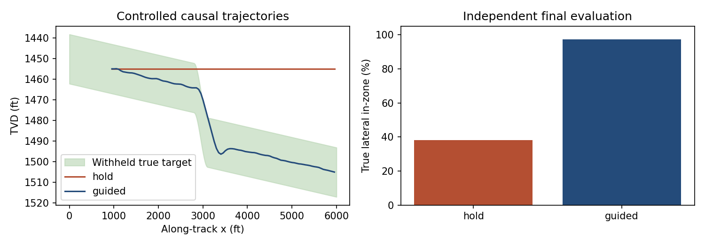
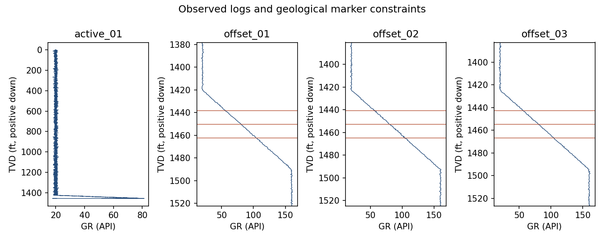
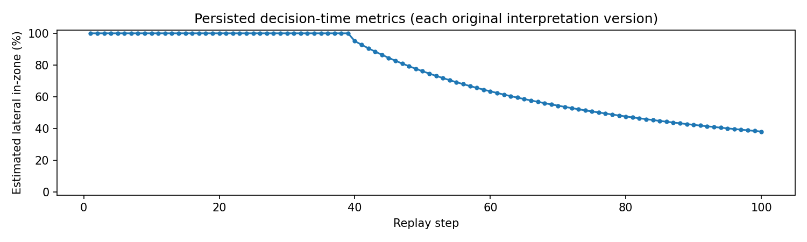
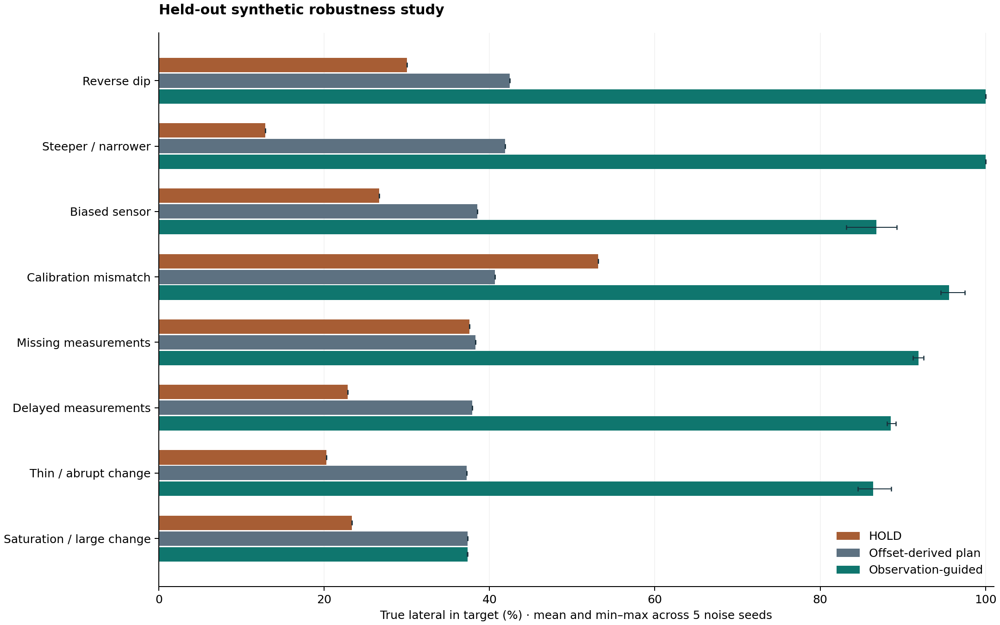
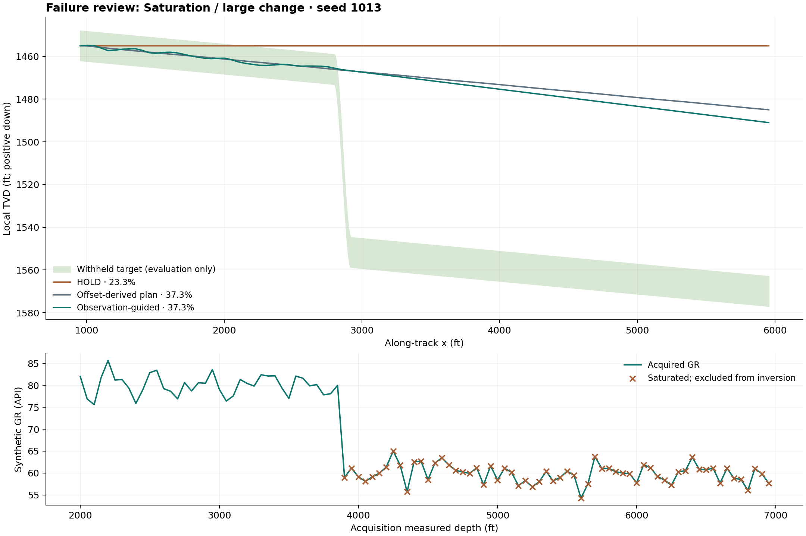
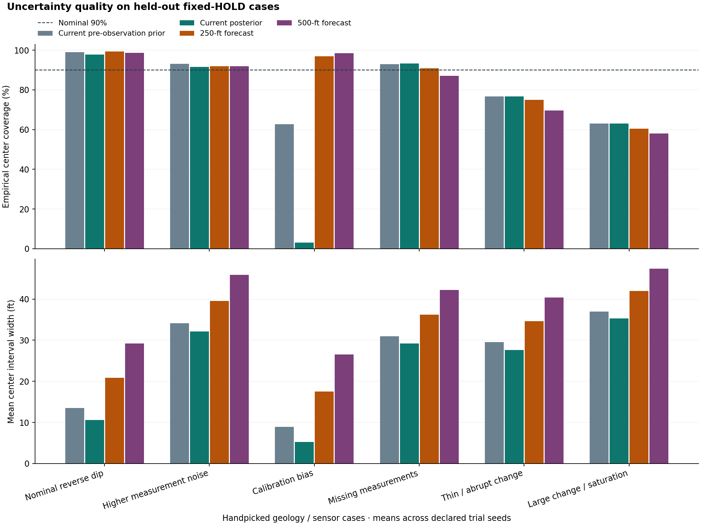
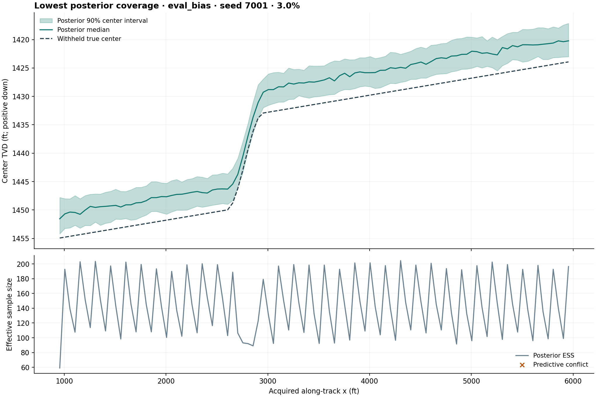

# Geosteering under structural uncertainty

## Problem

Three offset wells constrain a dipping target interval, but do not reveal a localized structural change farther along the active lateral. The study asks how progressively acquired logs improve an interpretation, and whether a bounded observation-guided policy can improve placement in the same fixed synthetic geology.

## Data and workflow

The versioned structural_dip_01 scenario contains three vertical offsets and one active well, LAS GR/resistivity logs, surveys, geological crossing markers and explicit local coordinate references. The target is 24 ft thick and the evaluated lateral is 5,000 ft long. Seed 123 is the reference experiment.

The operator estimates regional top/base from offset markers, solves the landing, and receives active measurements in successive intervals. Each recommendation cites observed log/position evidence and an immutable interpretation version. A separate evaluator reveals geological truth only after the run finishes.

The selected pre-job model now travels intact from Correlation to Planning and
the steering run. Plans and runs retain its version, selected offset wells,
boundary coordinates and evidence hashes. Changed source picks require a new
deliberately reviewed model before a new plan or run; earlier histories retain
their original evidence. A selected plan pins geology, while a causal run begins
at its acquired landing station rather than executing saved plan stations.

Before advancing a causal run, the operator can inspect requested versus effective
inclination, the next projected station, DLS and any clipping. This preview uses
acquired geometry and a captured public mechanics snapshot. It neither samples
future logs nor reads private geology. Fixed-path replay shows a recommendation
and reveal interval without inventing a future trajectory preview.

Replay and causal experiments answer different questions. The replay uses a fixed HOLD-like path, so its recommendations can improve interpretation but cannot improve recorded placement. The causal experiments start from the same landing state and apply actual bounded commands.

Decision Review reconstructs the saved information boundary at any recorded
step. Its decision phase shows the chosen interpretation and the observations
known before the command; its after phase adds that interval's observations and
original persisted diagnostic. A side-by-side fork comparison holds the frozen
experiment and acquired endpoint common while exposing divergent commands and
paths. The Evaluation page connects completed placement, interpretation error
and curvature checks to those histories. These views expose the existing evidence;
they do not change or recalibrate the scientific results below.

## Measured reference result

The reference HOLD run places approximately 38.1% of the lateral in the target. The observation-guided causal run places approximately 97.2% in target, while respecting the 3 degrees/100 ft lateral DLS limit. Exact lengths, center-distance errors, overshoot, clipping and action-change counts are in the generated summary.







These outcomes are specific to the known synthetic calibration, geometry and seed. The baseline comparison does not validate operational steering. Required report figures include the plan, DLS, observed correlations, interpretation, per-step diagnostics, recommendation timeline and completed comparison.

## Failure analysis

The offsets cannot predict the localized disturbance. In the fixed replay the well eventually leaves the target; recommendations do not change that outcome. Sufficiently distant observations saturate the synthetic sensor, so they cannot justify an exact center inversion. The replay records that information loss and carries an uncertain interpretation forward. Final interpretation residuals and true placement scores remain visible even when they are worse than an estimated diagnostic suggests.

The guided causal policy benefits from a disclosed signed stratigraphic signal. That assumption explains much of its performance and is a central limitation, not an operational capability claim.

## Held-out robustness study

The next experiment asks whether observation guidance remains useful when the
geology changes and measurements become imperfect. A versioned protocol fixes
two development controls, eight different evaluation configurations, disjoint
development/evaluation noise seeds, and three strategies before execution.
The complete study contains 132 trials: 12 development and 120 evaluation.

HOLD, an offset-derived regional plan and observation-guided feedback share the
same landing state, geology, mechanical limits and step-keyed random draws
within each case/seed pair. The regional plan follows a centerline fitted to
offset picks without using active-well logs. Guidance retains the reference
controller and its nominal GR calibration; a fixed validity wrapper excludes
missing/saturated measurements and retains the original acquisition pose of
delayed observations. It applies HOLD when no usable measurement arrives.

| Strategy | Mean true lateral in zone across evaluation cases |
| --- | ---: |
| HOLD | 28.34% |
| Offset-derived regional plan | 39.29% |
| Observation-guided | 85.83% |

Guided steering exceeds the regional-plan baseline in 38 of 40 evaluation
pairs, with a mean difference of 46.54 percentage points. The two slightly
negative differences occur in the saturation case; the minimum is −0.01174
percentage points. All 120 evaluation trials have zero lateral DLS violations
under the evaluator tolerance. These are descriptive outcomes for the predefined
synthetic configurations, not estimates of field performance.



### A decision sequence that fails

The saturation/large-change configuration shows the value and limits of the
information boundary:

1. Exact offset markers support a regional model but do not reveal the later
   structural change.
2. As the well diverges from the target, the instrument reaches its clipping
   range. Its validity flag prevents a saturated GR value from being treated as
   an exact center estimate.
3. With no new usable measurements, the fixed wrapper applies HOLD. Respecting
   the curvature bound does not restore geological observability or guarantee
   target placement.

The worst guided trial, seed 1013, has 62 saturated measurements, 37.31% in-zone
placement and a maximum excursion of 78.03 ft beyond a target boundary.
Its trajectory and measurements remain in the evidence rather than being
removed from the headline result.



The [full study](../case_studies/robustness_v1/README.md) contains per-case
outcomes, the executed manifest, paired CSVs and complete compressed event
histories. Source copies and protocol hashes were frozen before execution;
repeat runs confirm numerical reproducibility, not independent replication.
The evaluated cases are now observed and cannot serve as an untouched holdout
for future policy tuning.

These cases combine sensor and geological stresses in places, so they locate
failure regimes rather than isolate each factor's causal effect. Noise-seed
ranges describe variation within fixed geology. The sensor still supplies
signed-distance information when valid, offset picks remain idealized, and no
calibrated geological uncertainty distribution has been established.

## A conditional uncertainty ensemble

New synthetic runs can opt into a 256-member spatial particle ensemble. The
prior comes from the frozen offset model. Each acquired step uses at most one
new located GR measurement at its original pose, updates member weights through
the clipped forward sensor likelihood, and records an immutable snapshot.
Missing measurements add no likelihood. Systematic resampling controls weight
concentration; independent future process draws keep forecast spread visible
even when the current weights concentrate on one member.

The app shows weighted center intervals, independent thickness uncertainty,
effective model count, and conditional probability of being in the target. HOLD,
BUILD and DROP assessments share one geological forecast and the existing bounded
mechanics. They describe the next station, not whole-well success. Snapshot zero
already includes the acquired start measurement; it is not an untouched pre-job
prior. Current cards use exact saved weights; displayed forecast paths are Monte
Carlo approximations. Historical review and forks retain their original snapshots.

A separate frozen 34-trial study evaluates center intervals on fixed HOLD paths:
two development controls and six new evaluation configurations, with disjoint
seeds. It measures uncertainty quality rather than ranking steering policies.

| Nominal 90% center interval | Mean evaluation coverage | Mean width |
| --- | ---: | ---: |
| Before current observation | 81.22% | 25.67 ft |
| After current observation | 70.89% | 23.36 ft |
| 250-ft forecast | 85.73% | 31.79 ft |
| 500-ft forecast | 83.96% | 38.59 ft |



The nominal intervals are not calibrated guarantees. In the worst biased-sensor
trial, seed 7001, the posterior covered the true center at only **3 of 101
stations (2.97%)**, despite mean effective model count 145.43 and zero predictive
conflict flags. The undisclosed +8 API bias shifted the inferred center by about
4 ft under the assumed calibration. The model fit the biased observations while
remaining wrong about geology. Good-looking weights do not establish accuracy.



Coverage must be read alongside width and center error: wider forecasts can
cover a biased center without correcting their medians. Current prior/posterior
scores share the same locations; forecasts have explicit domain exclusions and
paired-origin results. Seed variation combines instrument variation and finite
ensemble Monte Carlo variation. Correlated stations are not independent samples,
and center coverage does not validate the separate thickness prior.

The [uncertainty study](../case_studies/uncertainty_v1/README.md) includes all
settings, valid point counts, event histories, diagnostics, source archive and
failure results. No settings were tuned to these outcomes; repeated execution
checks reproducibility, not independent confirmation. This evidence makes the
model's uncertainty assumptions testable and exposes substantial miscoverage.
The earlier placement benchmarks remain unchanged.

## Validation and reproduction

```powershell
python -m pip install -e ".[test,dev]"
python -m pytest
python -m ruff check app tools tests app.py
python -m build
python -m tools.run_case_study --out output/my-case-study --seed 123
python -m tools.run_robustness_study --out output/my-robustness-study
python -m tools.run_uncertainty_study --out output/my-uncertainty-study
```

Use a fresh output directory. The report, numerical summary, decision CSV, plan CSV and artifact manifest are under the generated project exports. The run manifest identifies input hashes, seed, scenario version, code revision and coordinate reference. Automated tests independently check geometry, interval scoring, information isolation, history, reproducibility, bounded causal consequences, PDF text and embedded images.

See [methods](methods.md) for the full contract and [limitations](limitations.md) for the scope of the conclusions.

## Portfolio wording

Implemented a reproducible synthetic geosteering workbench with evidence-pinned
interpretation/plan/run handoffs, acquired-only steering command previews,
minimum-curvature modeling, immutable decision-time metrics and independent
evaluation. A frozen 132-trial study tests three causal strategies across held-out
geological configurations and sensor stresses, including documented failures.

A separate portfolio repository or resume has not been modified.
