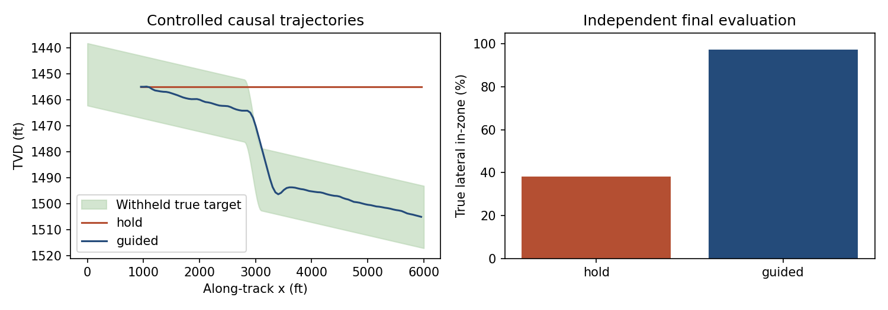
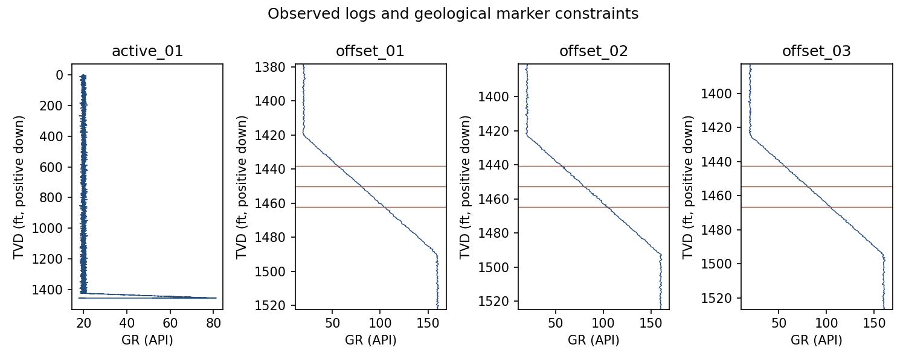
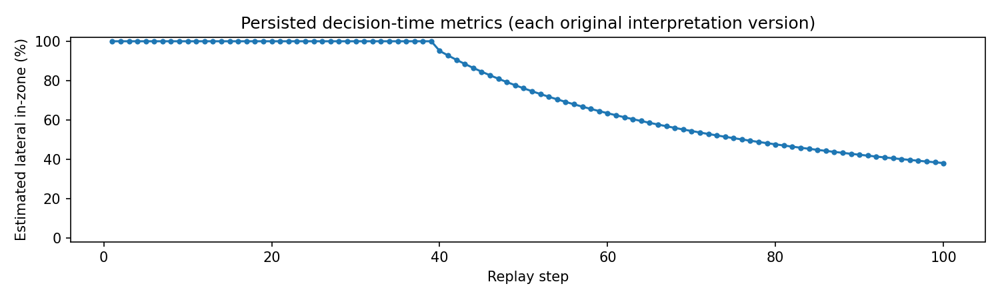

# Geosteering under structural uncertainty

## Problem

Three offset wells constrain a dipping target interval, but do not reveal a localized structural change farther along the active lateral. The study asks how progressively acquired logs improve an interpretation, and whether a bounded observation-guided policy can improve placement in the same fixed synthetic geology.

## Data and workflow

The versioned structural_dip_01 scenario contains three vertical offsets and one active well, LAS GR/resistivity logs, surveys, geological crossing markers and explicit local coordinate references. The target is 24 ft thick and the evaluated lateral is 5,000 ft long. Seed 123 is the reference experiment.

The operator estimates regional top/base from offset markers, solves the landing, and receives active measurements in successive intervals. Each recommendation cites observed log/position evidence and an immutable interpretation version. A separate evaluator reveals geological truth only after the run finishes.

Replay and causal experiments answer different questions. The replay uses a fixed HOLD-like path, so its recommendations can improve interpretation but cannot improve recorded placement. The causal experiments start from the same landing state and apply actual bounded commands.

## Measured reference result

The reference HOLD run places approximately 38.1% of the lateral in the target. The observation-guided causal run places approximately 97.2% in target, while respecting the 3 degrees/100 ft lateral DLS limit. Exact lengths, center-distance errors, overshoot, clipping and action-change counts are in the generated summary.







These outcomes are specific to the known synthetic calibration, geometry and seed. The baseline comparison does not validate operational steering. Required report figures include the plan, DLS, observed correlations, interpretation, per-step diagnostics, recommendation timeline and completed comparison.

## Failure analysis

The offsets cannot predict the localized disturbance. In the fixed replay the well eventually leaves the target; recommendations do not change that outcome. Sufficiently distant observations saturate the synthetic sensor, so they cannot justify an exact center inversion. The replay records that information loss and carries an uncertain interpretation forward. Final interpretation residuals and true placement scores remain visible even when they are worse than an estimated diagnostic suggests.

The guided causal policy benefits from a disclosed signed stratigraphic signal. That assumption explains much of its performance and is a central limitation, not an operational capability claim.

## Validation and reproduction

```powershell
python -m pip install -e ".[test,dev]"
python -m pytest
python -m ruff check app tools tests app.py
python -m build
python -m tools.run_case_study --out output/my-case-study --seed 123
```

Use a fresh output directory. The report, numerical summary, decision CSV, plan CSV and artifact manifest are under the generated project exports. The run manifest identifies input hashes, seed, scenario version, code revision and coordinate reference. Automated tests independently check geometry, interval scoring, information isolation, history, reproducibility, bounded causal consequences, PDF text and embedded images.

See [methods](methods.md) for the full contract and [limitations](limitations.md) for the scope of the conclusions.

## Portfolio wording

Implemented a reproducible synthetic geosteering workbench with LAS/survey QC, offset-derived spatial interpretation, minimum-curvature trajectory modeling, bounded causal steering, immutable decision-time metrics, and independent PDF-backed evaluation.

A separate portfolio repository or resume has not been modified.
