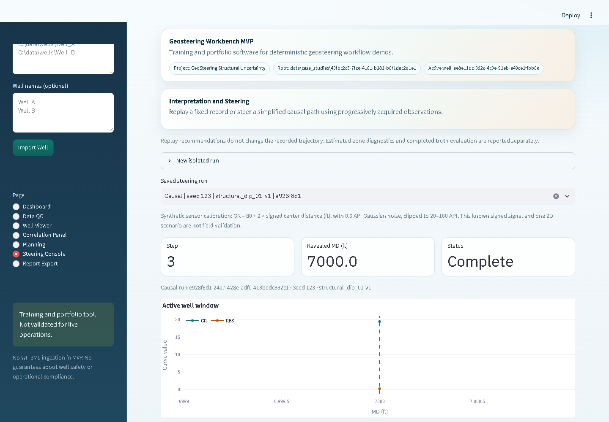
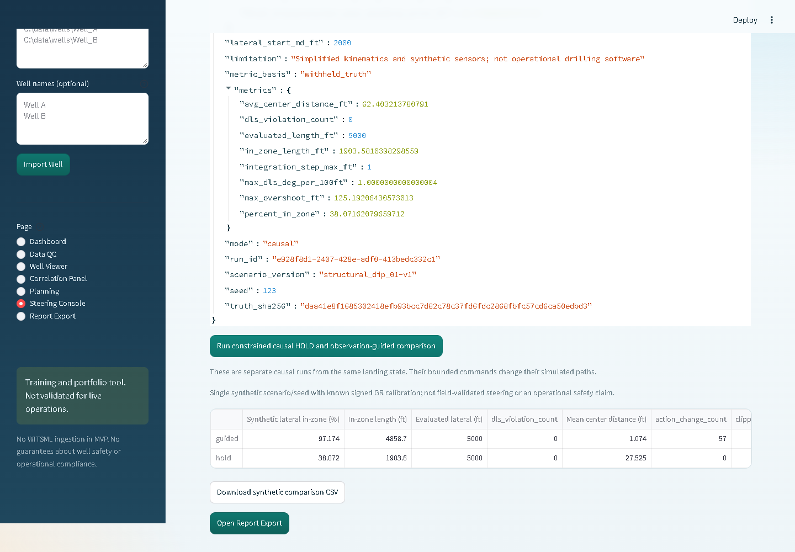
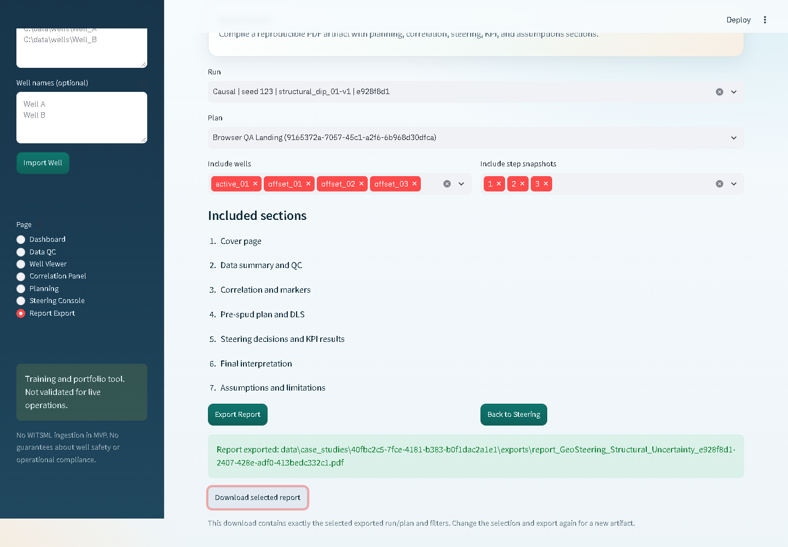
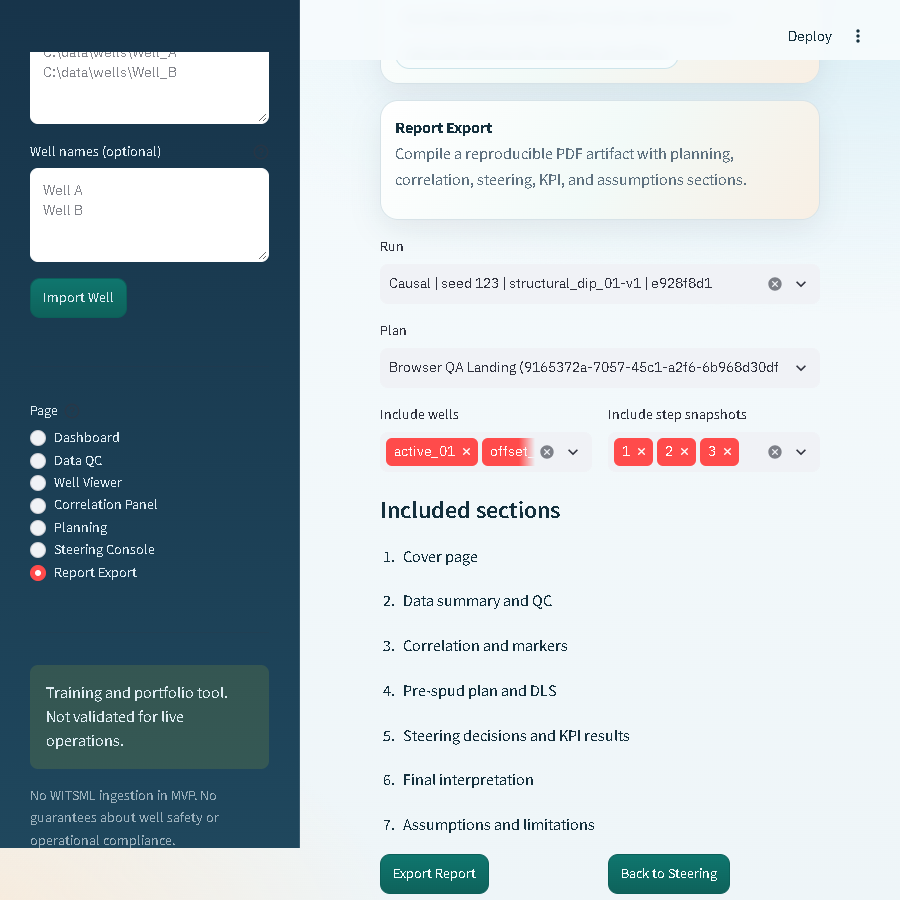
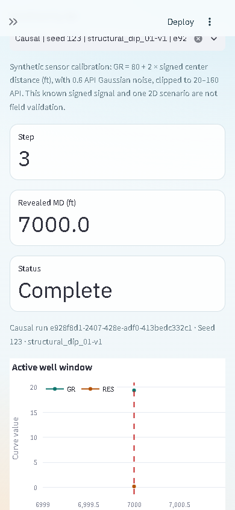
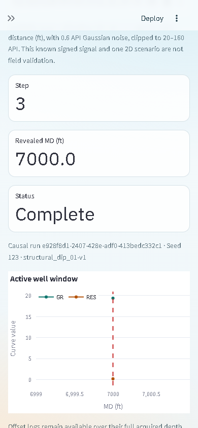
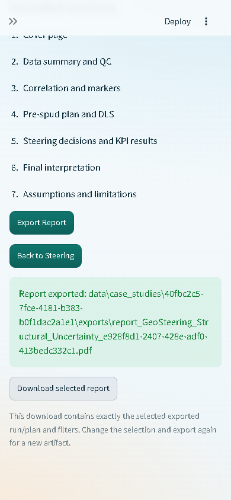

# GeoSteering Wave 2 browser QA

November 1, 2026. Local operator/report acceptance passed through actual browser
controls. This packet separates browser observations, backend tests, scientific
reference results and publication status. It does not claim field validation.

The profile is Windows, Streamlit 1.66.1, Playwright CLI 0.1.23 and headless
Chrome 156. The browser ran against a separately owned local Streamlit process;
no direct handler call was substituted for a UI action. Final source byte
identity, checksums and executed test counts are in [qa.json](qa.json).

## Actual browser inventory and results

| Check | Observed result |
| --- | --- |
| Dashboard case loader, sidebar open/create/reopen, Data QC | Fresh synthetic case; four valid wells, zero warnings; saved project reopens |
| Offset correlation and pre-job interpretation | Three observed offset curves/picks; offset-derived model saved |
| Landing preview and saved plan | 73 stations, zero DLS exceedances, separate 6 degrees/100 ft landing limit |
| Acquired data boundary | Actual Plotly GR/RES data end at MD 2000 before advance and 2050 afterward; future values absent |
| Duplicate submission | Real double-click yields one step, one decision and one receipt in replay and causal checks |
| Causal commands and fork | HOLD, then fork; BUILD requested 180 degrees/applied 95; DROP requested 0/applied 85; all 30 parent files unchanged |
| Report lifecycle | Partial, completed-unevaluated and completed-evaluated PDFs exported and downloaded by browser; states and independent scores correctly distinguished |
| Report scope | Selected run/plan/step filters remain explicit; changing selection removes the old download; all four selected wells retain their 20 input-hash paths |
| Run navigation | Selected older run persists across sidebar, keyboard and Back-to-Steering navigation even when a different filesystem run is active |
| Restart/reopen | New browser session and restarted server reopen persisted completed child at step 3/MD 7000 |
| Comparison evidence | Actual UI calculation and CSV download contain original 38.0716208% HOLD / 97.1742657% guided synthetic reference, 5000-ft denominators and scenario/seed/scope metadata |
| Keyboard | Arrow navigation, Tab traversal, Enter export and Enter PDF download; visible focus |
| Responsive viewports | 1440x1000, 900x900 and 390x844; document/main scroll widths equal client widths; mobile sidebar navigation and PDF download work |
| Singleton observations | Two visible GR/RES markers at current MD 7000 when the acquired window contains one station |
| Calibration and limits | Signed GR calibration, 0.6 API noise, 20-160 API clipping and synthetic/assumed-uncertainty limits visible |
| Final browser console | Zero errors/warnings in the independent final session |

The causal three-command exercise is a manual interface test, not an optimized
policy comparison. The paired reference is a separate actual calculation from
the shared landing state. Its known signed sensor, one 2D scenario and seed
limit the conclusion. No safety or geological-generalization claim is made.

## Downloaded artifacts and visual review

- [Partial replay PDF](partial.pdf): step 1, MD 2050, estimated-only metrics.
- [Completed-unevaluated PDF](complete-unevaluated.pdf): a newly created replay
  run completes without deleting any earlier evaluation; final truth score is
  explicitly unavailable.
- [Completed/evaluated PDF](complete-evaluated.pdf): actual selected causal
  history, independent retrospective scores and separate paired comparison.
- [Actual UI comparison CSV](comparison.csv): exact metrics with scenario,
  seed and synthetic-scope metadata.

Every page of the three final PDFs was rendered with Poppler and inspected:
4 partial, 4 unevaluated and 5 evaluated pages, 13 total. Text, tables, hashes,
axes, legends and footers were readable without observed clipping or overlap.
The PDFs contain 6, 6 and 7 embedded figures respectively. Input provenance
contains the 20 selected input-hash paths in each report.

## Defects found and fixed

Actual UI/artifact checks exposed missing browser report downloads, project
preview leakage, mutable selector labels cached with stale progress, lost
selected-run context during page-widget cleanup, invisible singleton readings,
and name/UUID mismatch in filtered report provenance. These were fixed without
changing scientific inputs, sensor assumptions or results.

An observed transient Windows access denial during atomic JSON replacement
led to a bounded rename-only retry for Windows sharing/access-denial codes.
Persistent denial still fails; original targets are preserved and temporary
files cleaned. Filesystem failures get recoverable UI feedback. Dedicated
regressions cover transient/permanent failures, project/session isolation,
stable labels, singleton/future clipping and selected/foreign-well provenance.

## Identity, audit and boundaries

This is the 0.2.3 dirty source snapshot based on
`9176b26a74972cdcaa8d0b41d1737bfa2c3fe8a3`. `qa.json` records its exact packaged
Python fingerprint and root UI-entrypoint hash. A later commit is not silently
substituted as the tested pristine revision. UI fixtures were preserved through
the fixes; new runs were created for new unevaluated checks rather than erasing
history. Original release packets/source identities remain unchanged.

Official checksum-verified Gitleaks 8.30.1 was run with vendor defaults against
all fetched refs/history, fully redacted and without inline/ignore suppressions.
The publication handoff adds a staged-tree scan and final post-commit history
audit. Private scanner details and raw browser traces stay outside this packet.
All tracked historical LAS/CSV inputs are generated samples; the only tracked
Volve path is its README. Raw Volve source/project directories remain excluded.
No credential or restricted raw-field-data artifact is included here.

This closes the recorded local GS-02 operator/browser gate. It does not certify
all devices/browsers, touch hardware, multi-process writers, operational use or
a remote deployment. No sensor research, robustness study, paid model call or
cloud-plan change occurred. Root release work owns remote publication.
